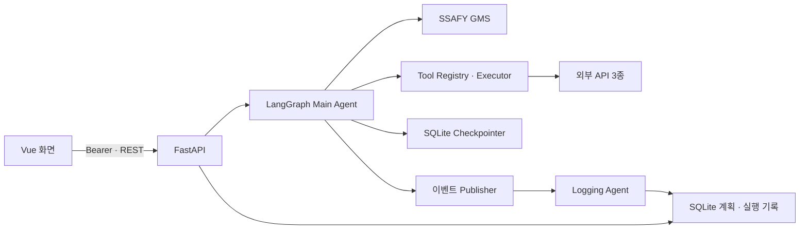
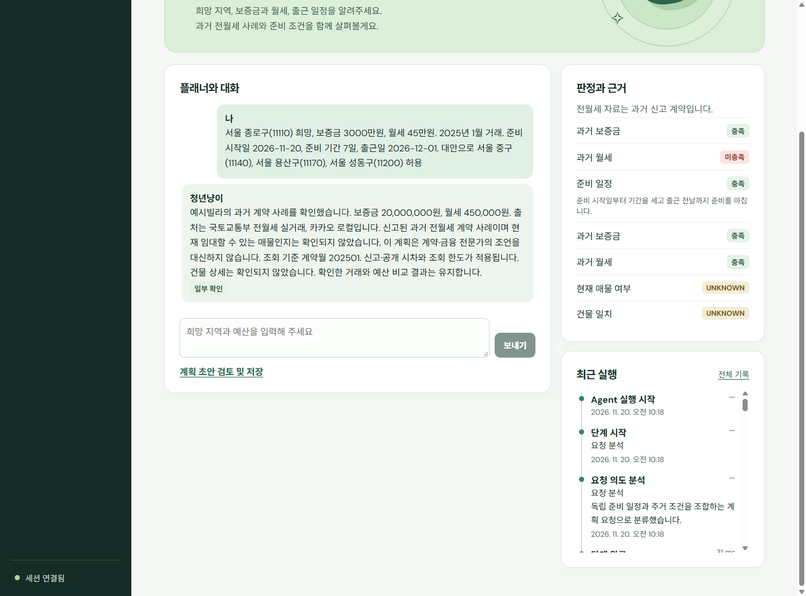
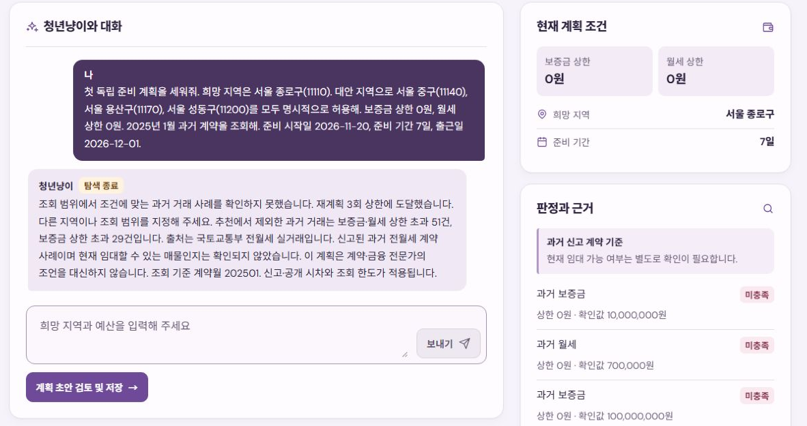
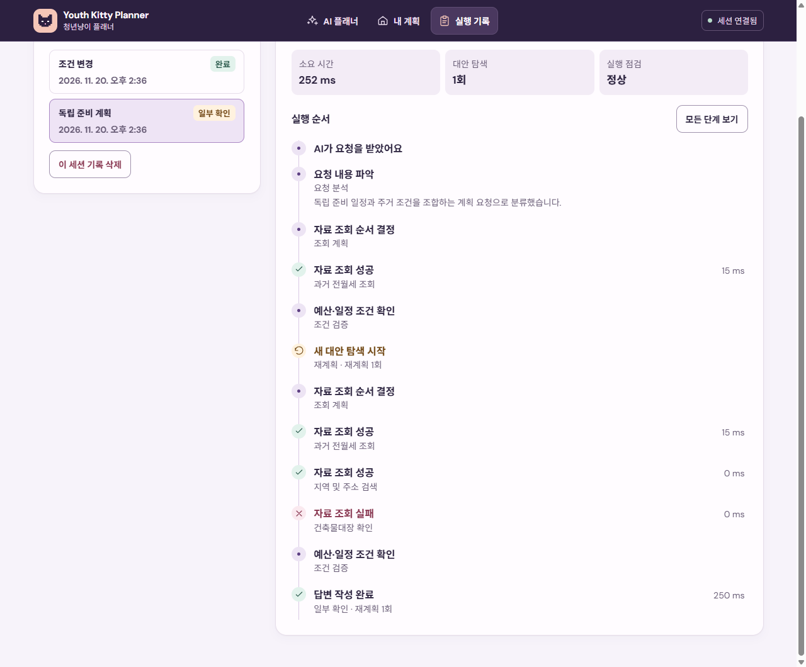

# Youth Kitty Planner · 청년냥이 플래너

첫 독립을 준비하는 청년이 주거 예산, 희망 지역, 출근 일정에 맞춰 실행할 일을 정리하는 서비스입니다. 신고된 과거 전월세와 건축물 정보를 조회해 계획에 근거를 붙입니다. 현재 임대 가능 여부와 근거가 부족한 건물 정보는 확인 필요로 표시합니다.

## 기술 스택

| 영역 | 사용 기술 |
|---|---|
| 프론트엔드 | Vue 3, Vue Router, Vite |
| 백엔드 | Python 3.11, FastAPI, Pydantic |
| Agent | LangGraph, SSAFY GMS Responses API |
| 저장소 | SQLite, LangGraph SQLite Checkpointer |
| 외부 데이터 | Kakao Local, 국토교통부 연립다세대 전월세, 건축HUB |

## 주요 기능

- **필수 기능 F3001~F3019** · 독립 준비 계획 생성, 예산·일정 조건 추출, 외부 API Tool Calling, 제약 판정과 최대 3회 재계획, 세션 Memory, 계획 저장·수정·삭제, Agent 실행 기록
- **선택 심화 F3020** · Tool 중복 호출, 재계획 초과, 계획 외 실행, 실행 누락을 규칙으로 판정합니다. 이상 판정에서만 GMS 진단을 요청합니다.

## 시스템 아키텍처



비즈니스 DB는 계획과 실행 이벤트를 저장합니다. 대화 조건은 세션별 Checkpointer에 보존하며, Logging Agent는 이벤트를 정제하고 저장할 때 LLM을 호출하지 않습니다. [Agent 설계·REST 계약](YKP_codex_handoff_v1/docs/ARCHITECTURE_AND_SCHEMA_v1.md) · [저장소 구조](YKP_codex_handoff_v1/docs/PROJECT_STRUCTURE_YKP.md)

## 실행 방법

Windows PowerShell에서 프로젝트 루트 기준으로 실행합니다.

```powershell
python -m venv .venv
.\.venv\Scripts\python.exe -m pip install -r requirements.txt
npm.cmd --prefix frontend ci
Copy-Item .env.example .env
```

기존 `.env`가 있으면 복사 명령을 생략합니다. 아래 환경변수를 설정한 뒤 별도 터미널에서 FastAPI와 Vue를 실행합니다.

```powershell
.\.venv\Scripts\python.exe -m uvicorn backend.app.main:app --host 127.0.0.1 --port 8000
npm.cmd --prefix frontend run dev
```

[플래너](http://127.0.0.1:5173/) · [Swagger](http://127.0.0.1:8000/docs) · [OpenAPI JSON](http://127.0.0.1:8000/openapi.json) · [헬스 체크](http://127.0.0.1:8000/api/v1/health)

외부 호출 없이 시연하려면 FastAPI 실행 명령을 아래 명령으로 바꿉니다. 이 모드는 Mock GMS·합성 외부 데이터와 임시 SQLite를 사용합니다.

```powershell
.\.venv\Scripts\python.exe -m uvicorn ui_preview:create_preview --factory --app-dir tests/integration --host 127.0.0.1 --port 8000
```

예시 요청은 “서울 종로구(11110) 희망, 보증금 3000만원, 월세 45만원. 2025년 1월 거래. 준비 시작일 2026-11-20, 준비 기간 7일, 출근일 2026-12-01. 대안으로 서울 중구(11140), 서울 용산구(11170), 서울 성동구(11200) 허용”입니다. 이어서 “월세만 55만원으로 바꿔줘”를 전송한 뒤 계획 저장과 실행 기록을 확인합니다.

## API 키 발급 및 설정

| 서비스 | 발급 경로 | 환경변수 |
|---|---|---|
| SSAFY GMS | [GMS 포털](https://gms.ssafy.io/) | `GMS_KEY`, `GMS_URL`(Responses 엔드포인트), `GMS_MODEL` |
| 카카오 로컬 | [카카오디벨로퍼스](https://developers.kakao.com/)의 앱 설정에서 REST 키 확인 및 카카오맵 활성화 | `KAKAO_REST_API_KEY` |
| 연립다세대 전월세 | [공공데이터포털 활용 신청](https://www.data.go.kr/data/15126473/openapi.do) | `MOLIT_RENT_API_KEY` |
| 건축HUB | [공공데이터포털 활용 신청](https://www.data.go.kr/data/15134735/openapi.do) | `BUILDING_HUB_API_KEY` |

## 외부 API 출처 및 이용 조건

| 제공자 | 이용 조건과 실제 확인값 |
|---|---|
| 카카오 로컬 | 카카오맵 최초 활성 앱 무료 쿼터 정책. 실제 앱에서 주소·키워드 각각 일일 100,000건 적용을 확인했습니다. [공식 쿼터](https://developers.kakao.com/docs/ko/getting-started/quota) · [카카오맵 정책](https://developers.kakao.com/docs/ko/kakaomap/common) · [운영 정책](https://developers.kakao.com/terms/ko/site-policies) |
| 연립다세대 전월세 | 무료, 이용허락범위 제한 없음. 승인 개발계정의 전월세 조회 일일 10,000건을 확인했습니다. [공식 데이터 및 조건](https://www.data.go.kr/data/15126473/openapi.do) |
| 건축HUB | 무료, 이용허락범위 제한 없음. 승인 개발계정의 표제부 조회 일일 10,000건을 확인했습니다. [공식 데이터 및 조건](https://www.data.go.kr/data/15134735/openapi.do) · [공공데이터포털 이용 정책](https://www.data.go.kr/ugs/selectPortalPolicyView.do) |

확인 당시 두 공공 API의 적용 기간은 2026-11-19~2028-11-19이며 누적 호출량은 미확인입니다. 공개량과 실제 적용량, 코드의 호출 범위는 검증 문서에 구분해 기록했습니다. [실제 적용 화면](reports/evidence/checklist-26-account-quotas.png) · [이용 조건 검증](reports/verification.md#외부-api-이용-조건)

## 실행 화면

| 계획과 제약 | 계획 관리와 실행 기록 |
|---|---|
| AI 계획 생성 · Mock | 계획 관리와 중복 일정 경고 · Mock |
|  |  |
| 재계획 3회 종료 · 실연동 | Agent 실행과 재계획 타임라인 · Mock |
|  |  |

[AI 플래너 대기 화면](reports/evidence/checklist-23-live-wait.png) · [F3020 이상 징후 판정](reports/evidence/checklist-28-anomaly.png) · [전체 화면과 로그](reports/evidence/)

## 검증 및 제출 자료

- [공식 셀프 체크리스트](셀프체크리스트.xlsx) · 필수 27/27, F3020 통과, 미확인 0개. 23·27번은 제출자가 직접 확인했습니다.
- [통합 검증 결과](reports/verification.md) · [요구사항 추적·Agent 설계·API 명세](YKP_codex_handoff_v1/docs/ARCHITECTURE_AND_SCHEMA_v1.md) · [Tool 정의](reports/evidence/phase-01-tool-specs.json)
- [대표 시나리오 5건과 전체 로그](reports/evidence/day-03-scenarios.json) · [API 화면](reports/evidence/checklist-docs.png) · [구현 소스](backend/app/) · [Vue 소스](frontend/src/)

공식 요구사항 원본은 대외비로 로컬에서 확인합니다. 실제 GMS·외부 API 연결과 Mock 회귀 결과는 통합 문서에서 확인할 수 있습니다.
