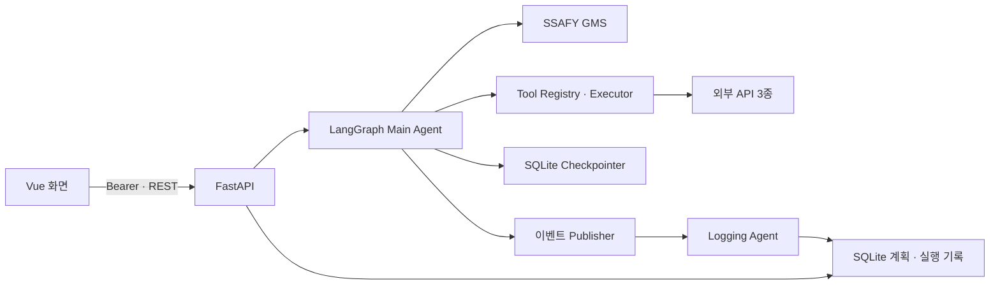
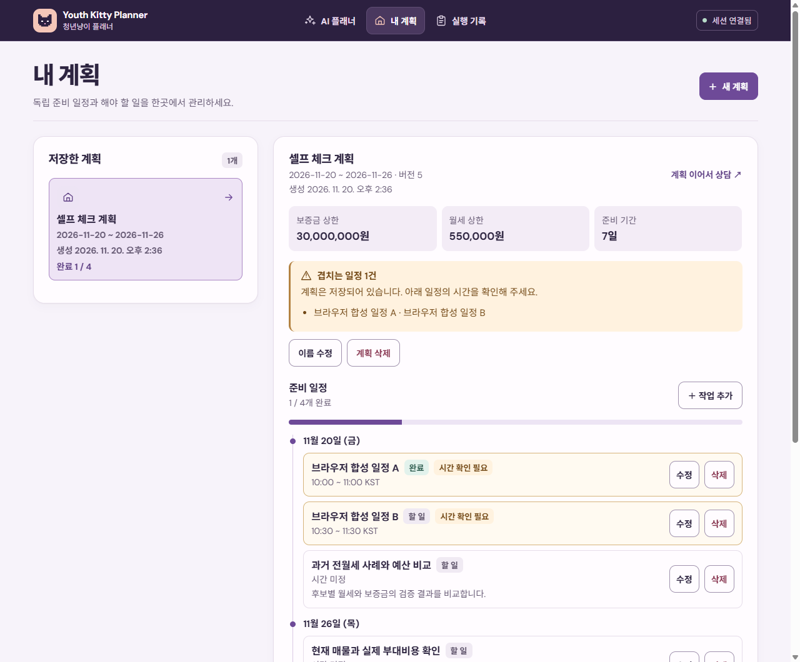

# Youth Kitty Planner · 청년냥이 플래너

## 서비스 소개

청년냥이 플래너는 첫 독립을 준비하는 청년이 주거 예산, 희망 지역, 첫 출근일을 바탕으로 무엇을 언제 확인해야 할지 정리하는 AI 플래너입니다. 예를 들어 “종로구에서 보증금 3,000만 원과 월세 60만 원으로 첫 출근 전 독립을 준비하고 싶어요”라고 입력하면, 과거 전월세 신고 사례를 예산과 비교하고 입주 전에 확인할 일을 일정으로 정리합니다.

채팅에서 만든 계획은 저장하고 이후에 조건을 바꿔 이어서 검토할 수 있습니다. 계획에 참고한 거래와 건축물 정보의 출처를 표시하며, 현재 임대 가능 여부와 근거가 부족한 건물 정보는 확인 필요로 남깁니다.

## 기술 스택

| 영역 | 사용 기술 |
|---|---|
| 프론트엔드 | Vue 3, Vue Router, Vite |
| 백엔드 | Python 3.11, FastAPI, Pydantic |
| Agent | LangGraph, SSAFY GMS Responses API |
| 저장소 | SQLite, LangGraph SQLite Checkpointer |
| 외부 데이터 | Kakao Local, 국토교통부 연립다세대 전월세, 건축HUB |

## 주요 기능

- **필수 기능 F3001~F3019** · 희망 지역과 예산에 맞춰 독립 준비 계획을 세우고, 카카오 로컬·과거 전월세·건축HUB 데이터를 조회합니다. 예산·일정 제약을 판단해 필요할 때 최대 3회 재계획합니다. 같은 세션에서 조건을 바꾸고, 계획을 저장·조회·수정·삭제하며, Agent 단계와 Tool 호출 기록을 확인할 수 있습니다.
- **선택 심화 F3020** · Tool 중복 호출, 재계획 초과, 계획 외 실행, 실행 누락을 규칙으로 판정합니다. 이상 판정에서만 GMS 진단을 요청합니다.

## 시스템 아키텍처



비즈니스 DB는 계획과 실행 이벤트를 저장합니다. 대화 조건은 세션별 Checkpointer에 보존하며, Logging Agent는 이벤트를 정제하고 저장할 때 LLM을 호출하지 않습니다. [Agent 설계·REST 계약](YKP_codex_handoff_v1/docs/ARCHITECTURE_AND_SCHEMA_v1.md) · [저장소 구조](YKP_codex_handoff_v1/docs/PROJECT_STRUCTURE_YKP.md)

## 실행 방법

Windows의 Git Bash 기준입니다. Python 3.11과 Node.js/npm을 준비하고, 각 터미널에서 프로젝트 루트를 작업 폴더로 사용합니다.

### 설치 및 설정

#### STEP 1. 프로젝트 폴더 이동

저장소를 내려받은 상위 폴더에서 프로젝트 루트로 이동합니다. 이미 프로젝트 루트에 있다면 생략합니다.

```bash
cd Youth-Kitty-Planner
```

#### STEP 2. 가상환경 생성 및 활성화

프로젝트의 Python 가상환경을 활성화합니다. 기존 `.venv`가 있다면 첫 번째 명령을 생략합니다.

```bash
python -m venv .venv
source .venv/Scripts/activate
```

#### STEP 3. 백엔드 의존성 설치

활성화한 가상환경에 FastAPI와 Agent 실행에 필요한 패키지를 설치합니다.

```bash
pip install -r requirements.txt
```

#### STEP 4. 프론트엔드 의존성 설치

잠금 파일에 맞춰 Vue 프론트엔드 패키지를 설치합니다.

```bash
npm.cmd --prefix frontend ci
```

#### STEP 5. 환경변수 설정

설정 예시를 `.env`로 복사합니다. **기존 `.env`가 있으면 이 명령을 생략합니다.** Mock으로 시연할 때는 이 단계 전체를 생략할 수 있습니다.

```bash
cp .env.example .env
```

`.env`에 발급받은 `GMS_KEY`, `KAKAO_REST_API_KEY`, `MOLIT_RENT_API_KEY`, `BUILDING_HUB_API_KEY`를 입력하고, `GMS_URL`에는 Responses 엔드포인트, `GMS_MODEL`에는 사용할 모델 ID를 설정합니다. [API 키 발급 및 설정](#api-키-발급-및-설정)

### 서버 실행 및 접속

#### STEP 6. 백엔드 실행 — 터미널 1

가상환경을 활성화한 Git Bash에서 FastAPI를 8000번 포트로 실행하고 터미널을 열어 둡니다.

```bash
python -m uvicorn backend.app.main:app --reload --host 127.0.0.1 --port 8000
```

#### STEP 7. 프론트엔드 실행 — 터미널 2

새 Git Bash를 열고 프로젝트 루트에서 Vue 개발 서버를 실행합니다.

```bash
npm.cmd --prefix frontend run dev
```

#### STEP 8. 웹사이트 접속

두 서버가 시작되면 브라우저에서 플래너를 열고 필요에 따라 백엔드 문서와 상태를 확인합니다.

| 주소 | 용도 |
|---|---|
| [http://127.0.0.1:5173](http://127.0.0.1:5173) | 청년냥이 플래너 웹사이트 |
| [http://127.0.0.1:8000/docs](http://127.0.0.1:8000/docs) | FastAPI Swagger 문서 |
| [http://127.0.0.1:8000/api/v1/health](http://127.0.0.1:8000/api/v1/health) | 서버 정상 작동 확인 |

> `http://127.0.0.1:8000/`은 루트 경로가 정의되어 있지 않아 `404 Not Found`가 정상입니다. 서버 상태는 `/api/v1/health`에서 확인합니다.

### Mock 시연 방법

API 키 없이 시연하려면 **터미널 1에서 STEP 6 대신** 아래 명령을 실행합니다. 두 백엔드는 모두 8000번 포트를 사용하므로 기존 FastAPI가 켜져 있다면 `Ctrl+C`로 먼저 종료합니다. Vue 실행과 웹사이트 접속은 STEP 7~8과 같습니다.

```bash
python -m uvicorn ui_preview:create_preview --factory --app-dir tests/integration --host 127.0.0.1 --port 8000
```

Mock 서버는 합성 GMS 응답과 외부 데이터, 임시 SQLite를 사용합니다.

예시 요청은 “서울 종로구(11110) 희망, 보증금 3000만원, 월세 45만원. 2025년 1월 거래. 준비 시작일 2026-11-20, 준비 기간 7일, 출근일 2026-12-01. 대안으로 서울 중구(11140), 서울 용산구(11170), 서울 성동구(11200) 허용”입니다. 이어서 “월세만 55만원으로 바꿔줘”를 전송한 뒤 계획 저장과 실행 기록을 확인합니다.

## API 키 발급 및 설정

| 서비스 | 발급 경로 | 환경변수 |
|---|---|---|
| SSAFY GMS | [GMS 포털](https://gms.ssafy.io/) | `GMS_KEY`, `GMS_URL`(Responses 엔드포인트), `GMS_MODEL` |
| 카카오 로컬 | [카카오디벨로퍼스](https://developers.kakao.com/)의 앱 설정에서 REST 키 확인 및 카카오맵 활성화 | `KAKAO_REST_API_KEY` |
| 연립다세대 전월세 | [공공데이터포털 활용 신청](https://www.data.go.kr/data/15126473/openapi.do) | `MOLIT_RENT_API_KEY` |
| 건축HUB | [공공데이터포털 활용 신청](https://www.data.go.kr/data/15134735/openapi.do) | `BUILDING_HUB_API_KEY` |

## 외부 API 출처 및 이용 조건

| 제공자 | 이용 조건과 실제 확인값 |
|---|---|
| 카카오 로컬 | 카카오맵 최초 활성 앱 무료 쿼터 정책. 실제 앱에서 주소·키워드 각각 일일 100,000건 적용을 확인했습니다. [공식 쿼터](https://developers.kakao.com/docs/ko/getting-started/quota) · [카카오맵 정책](https://developers.kakao.com/docs/ko/kakaomap/common) · [운영 정책](https://developers.kakao.com/terms/ko/site-policies) |
| 연립다세대 전월세 | 무료, 이용허락범위 제한 없음. 승인 개발계정의 전월세 조회 일일 10,000건을 확인했습니다. [공식 데이터 및 조건](https://www.data.go.kr/data/15126473/openapi.do) |
| 건축HUB | 무료, 이용허락범위 제한 없음. 승인 개발계정의 표제부 조회 일일 10,000건을 확인했습니다. [공식 데이터 및 조건](https://www.data.go.kr/data/15134735/openapi.do) · [공공데이터포털 이용 정책](https://www.data.go.kr/ugs/selectPortalPolicyView.do) |

확인 당시 두 공공 API의 적용 기간은 2026-11-19~2028-11-19이며 누적 호출량은 미확인입니다. 공개량과 실제 적용량, 코드의 호출 범위는 검증 문서에 구분해 기록했습니다. [실제 적용 화면](reports/evidence/checklist-26-account-quotas.png) · [이용 조건 검증](reports/verification.md#외부-api-이용-조건)

## 실행 화면

| 계획과 제약 | 계획 관리와 실행 기록 |
|---|---|
| AI 계획 생성 · Mock | 계획 관리와 중복 일정 경고 · Mock |
|  |  |
| 재계획 3회 종료 · 실연동 | Agent 실행과 재계획 타임라인 · Mock |
|  |  |

[AI 플래너 대기 화면](reports/evidence/checklist-23-live-wait.png) · [F3020 이상 징후 판정](reports/evidence/checklist-28-anomaly.png) · [전체 화면과 로그](reports/evidence/)

## 검증 및 제출 자료

- [공식 셀프 체크리스트](셀프체크리스트.xlsx) · 필수 27/27, F3020 통과, 미확인 0개. 23·27번은 제출자가 직접 확인했습니다.
- [통합 검증 결과](reports/verification.md) · [요구사항 추적·Agent 설계·API 명세](YKP_codex_handoff_v1/docs/ARCHITECTURE_AND_SCHEMA_v1.md) · [Tool 정의](reports/evidence/phase-01-tool-specs.json)
- [대표 시나리오 5건과 전체 로그](reports/evidence/day-03-scenarios.json) · [API 화면](reports/evidence/checklist-docs.png) · [구현 소스](backend/app/) · [Vue 소스](frontend/src/)

공식 요구사항 원본은 대외비로 로컬에서 확인합니다. 실제 GMS·외부 API 연결과 Mock 회귀 결과는 통합 문서에서 확인할 수 있습니다.

## 느낀 점

- **계획을 믿고 쓰려면 판단 근거가 보여야 합니다.** 과거 거래가 예산에 맞더라도 현재 임대 가능 여부는 별도 확인이 필요합니다. 확인한 사실과 불확실한 부분을 함께 보여줘야 사용자가 다음 행동을 결정할 수 있다는 점을 배웠습니다.
- **저장한 계획을 다시 여는 과정까지 검증해야 합니다.** 후보별 증빙을 보존해도 같은 링크를 반복해 보여주면 읽기 어렵고, 여러 날에 걸친 작업에서 날짜를 생략하면 일정이 잘못 보입니다. 실제 저장 화면을 확인하며 근거와 일정을 사용자에게 어떻게 전달할지 다시 살폈습니다.
- **실연동과 Mock 검증은 서로 다른 질문에 답합니다.** 실제 호출로는 제공자 응답과 대기 시간을 확인했고, Mock으로는 도구 실패·조건 변경·재계획을 반복해 검증했습니다. 실행 기록을 남기니 문제를 어느 단계에서 살펴봐야 하는지 파악하기 쉬웠습니다.
