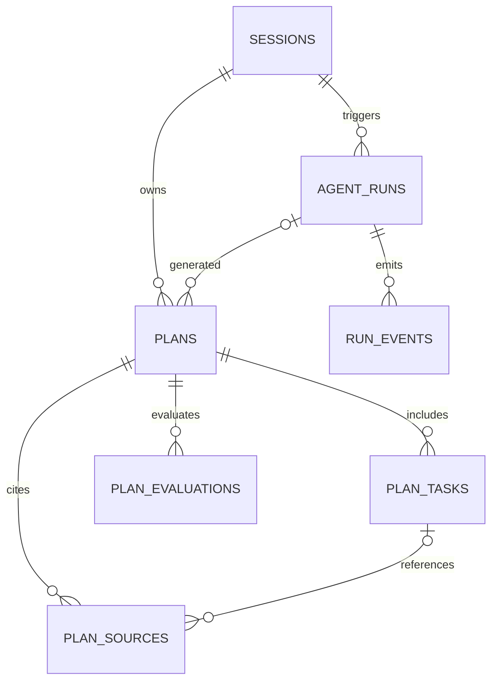

# Youth Kitty Planner (청년냥이 플래너, YKP) — Agent·DB·API 스키마 설계서 v1.0

- 상태: **구현 전 확정안 / 외부 API 실제 응답은 미검증**
- 폴더 구조: `docs/PROJECT_STRUCTURE_YKP.md` 참고. 기존 코드 식별자/API/DB 명칭은 브랜딩 변경만으로 수정하지 않음.
- 대상: SSAFY AI 코어 3회차 3일 MVP, 도메인 `첫 취업 후 독립 준비`
- 기준 문서: 사용자가 제공한 `AI코어프로젝트_3회차_요구사항정의서(4).pdf` (F3001~F3019, NF3001~NF3007)
- 스택: Python 3.10+, FastAPI, Pydantic v2, LangGraph, SQLite, Vue 3(레포 상태에 맞춰 조정 가능)
- 제외: 코드 구현, 배포, 전체 Fork/커뮤니티, 검증되지 않은 부동산 계약 안전성 판단

## 0. 계약 범위와 해석 규칙

1. 공식 PDF **필수 기능을 축소하거나 다른 기능으로 대체하지 않는다.** F3020~F3023은 선택 심화이며 필수 기능이 끝난 뒤에만 수행한다.
2. 세 API 키 확보는 사용자 확인 사항이다. **카카오 로컬·국토부 연립다세대 전월세 실거래·건축HUB 건축물대장**의 실제 API 응답·Tool 호환성·후보→상세 데이터 연결 여부는 아직 확인하지 못했다. 이는 Codex Phase 1 게이트다.
3. F3002는 **과거 임대차 거래 후보**를 반환한다. 이를 `현재 올라온 매물`이라고 표시하지 않는다. F3003은 후보의 건축물 상세를 조회하되, 정확한 건물 식별을 못 하면 `AMBIGUOUS/NOT_FOUND/UNKNOWN`으로 표시한다. **시군구/동 코드만 같다고 동일 건물로 연결하지 않는다.**
4. LLM은 의도·조건 추출, Tool 호출 계획, 대안 설명에 사용한다. 예산·기간 비교, 권한 확인, 시간 중복, 재계획 횟수, 데이터 저장은 결정적 코드로 처리한다.
5. 사용자가 고정한 제약(월세 상한, 보증금 상한, 출근일, 허용 지역)은 사용자 승인 없이 완화하지 않는다.
6. `null`은 미확인 값이며 `0`과 다르다. 확인되지 않은 관리비·시간·날짜를 생성하지 않는다.
7. F3015에서 **시간이 겹치는 계획은 저장을 허용하고 경고**한다. F3014 실행 로그는 목록·상세·삭제만 제공하며 수정 API가 없다.
8. 원본 이벤트는 **발행 직전 민감정보를 제거한 정형 이벤트**를 의미한다. 로깅 Agent는 구독 후 그 원본을 LLM 없이 순서대로 저장하며 요약으로 대체하지 않는다.
9. 모든 시나리오는 실제 API 응답을 우선하고, 샘플/모킹 시 명확히 표시한다. API 실패를 성공으로 포장하지 않는다.

## 1. DB 스키마 (SQLite MVP)

전제: 외부 서비스 사용자 계정이 없는 3일 MVP. 세션은 서버가 발급한 무작위 opaque token(최소 256비트)으로 보호하고 DB에는 **토큰 원문 대신 해시**를 저장한다. 클라이언트는 `Authorization: Bearer <token>`으로 전달한다. 저장·조회·수정·삭제·로그 조회는 세션 소유권 검사가 필수다. 세션 만료·갱신 정책을 구현하고 데모 계정/토큰을 운영에 하드코딩하지 않는다. 인증 구현이 어려울 경우 Reviewer에게 별도 보고하고 기능을 임의로 삭제하지 않는다.

### 1.1 테이블 정의

표에서 `?`는 NULL 허용. `UUID`는 SQLite에서 TEXT로 저장. 시각은 UTC ISO8601(offset 포함)로 저장하며 화면은 Asia/Seoul로 표시. 금액은 **KRW 정수**. 모든 사용자 제공 문자열은 길이 상한·제어 문자 제한을 적용한다.

**sessions**

| 컬럼 | 타입 | 조건 / 의미 |
|---|---|---|
| id | UUID | PK, 서버 생성 |
| token_hash | TEXT | UNIQUE, NOT NULL, 서버 전용·응답 금지 |
| created_at | DATETIME | NOT NULL |
| last_used_at | DATETIME | NOT NULL |
| expires_at | DATETIME | NOT NULL |

**plans**

| 컬럼 | 타입 | 조건 / 의미 |
|---|---|---|
| id | UUID | PK, 서버 생성 |
| session_id | UUID | FK sessions.id, NOT NULL, INDEX |
| title | VARCHAR(160) | NOT NULL |
| category | TEXT | enum `FIRST_JOB_INDEPENDENCE`(MVP 고정) |
| planning_start_date | DATE | NOT NULL |
| planning_end_date | DATE | NOT NULL, `>= start_date` |
| work_location_label | TEXT? | 지리 식별 불가 시 이름만 저장 |
| constraints_json | JSON | NOT NULL, Pydantic `UserConstraints` 검증 |
| generated_by_run_id | UUID? | FK agent_runs.id, 기록 없으면 null |
| revision_number | INTEGER | default 1, >=1 (낙관적 동시성용, **버전 스냅샷 아님**) |
| created_at | DATETIME | NOT NULL |
| updated_at | DATETIME | NOT NULL |

**plan_tasks**

| 컬럼 | 타입 | 조건 / 의미 |
|---|---|---|
| id | UUID | PK, 안정적인 작업 식별자 |
| plan_id | UUID | FK plans.id ON DELETE CASCADE, INDEX |
| title | VARCHAR(160) | NOT NULL |
| description | TEXT? | 선택 |
| task_date | DATE | NOT NULL, 계획 날짜 범위 밖이면 경고/검증 정책 적용 |
| scheduled_start_at | DATETIME? | 시간 확정 시 UTC aware datetime |
| scheduled_end_at | DATETIME? | start와 쌍으로만 존재, end > start |
| status | TEXT | `TODO`, `IN_PROGRESS`, `DONE`, `SKIPPED` |
| estimated_cost_krw | INTEGER? | >=0, 미확인=null |
| actual_cost_krw | INTEGER? | >=0, 사용자 실행 기록(후순위 UI) |
| estimated_duration_minutes | INTEGER? | >0 |
| actual_duration_minutes | INTEGER? | >0, 사용자 실행 기록(후순위 UI) |
| source_kind | TEXT | `RULE`, `AI_DRAFT`, `USER_EDIT`, `FORK_IMPORT`(예약) |
| sort_order | INTEGER | >=0 |
| created_at | DATETIME | NOT NULL |
| updated_at | DATETIME | NOT NULL |

주의: **달력 시간 미확정이면 start/end 둘 다 null**. 임의로 09:00 같은 시간을 넣지 않는다. 같은 날 시간 충돌은 start/end 둘 다 있는 작업끼리만 검사하며, 같은 세션이 소유한 서로 다른 계획의 작업과 해당 계획 내부 작업을 포함한다. 교집합은 `A.start < B.end AND B.start < A.end`. 저장은 성공하고 경고를 응답한다. NULL 시간에는 `TIME_NOT_SET` 안내를 별도로 줄 수 있으나 '중복'으로 판정하지 않는다.

**agent_runs**

| 컬럼 | 타입 | 조건 / 의미 |
|---|---|---|
| id | UUID | PK |
| session_id | UUID | FK sessions.id, INDEX |
| thread_id | TEXT | 해당 세션에서 서버 생성한 LangGraph thread ID |
| intent | TEXT? | 요청 의도 enum |
| status | TEXT | `RUNNING`, `SUCCEEDED`, `PARTIAL`, `NEEDS_INPUT`, `FAILED`, `EXHAUSTED` |
| replan_count | INTEGER | >=0, 각 실행마다 0으로 시작 |
| started_at | DATETIME | NOT NULL |
| finished_at | DATETIME? | 종료 시 설정 |
| safe_error_code | TEXT? | 대외 표시 가능한 코드 |

**run_events** (append-only: UPDATE 금지, DELETE는 세션 로그 삭제 API로만)

| 컬럼 | 타입 | 조건 / 의미 |
|---|---|---|
| id | UUID | PK |
| run_id | UUID | FK agent_runs.id, INDEX |
| sequence | INTEGER | NOT NULL, `(run_id, sequence)` UNIQUE |
| event_type | TEXT | 정의된 이벤트 enum |
| node_name | TEXT? | 해당 노드 |
| occurred_at | DATETIME | NOT NULL |
| duration_ms | INTEGER? | >=0 |
| payload_json | JSON | NOT NULL, 발행 전 정제된 원본 |

**plan_sources**

| 컬럼 | 타입 | 조건 / 의미 |
|---|---|---|
| id | UUID | PK |
| plan_id | UUID | FK plans.id ON DELETE CASCADE |
| task_id | UUID? | FK plan_tasks.id, 작업 단위 인용 시 |
| source_type | TEXT | `OFFICIAL_API`, `USER_INPUT`, `USER_EXPERIENCE`, `AI_ESTIMATE`, `EVIDENCE_VERIFIED` |
| provider | TEXT? | `KAKAO_LOCAL`, `MOLIT_RENT`, `BUILDING_HUB` 등 |
| source_ref | TEXT? | 실제 공식 응답 식별자 또는 내부 참조. 인증정보 금지 |
| source_url | TEXT? | 공개 가능 공식 문서/항목 URL일 때만 |
| fetched_at | DATETIME? | 실제 조회 시각 |
| observed_at | DATETIME? | 자료가 가리키는 시점(거래일 등) |
| verification_status | TEXT | `UNVERIFIED`, `SOURCE_CONFIRMED`, `EVIDENCE_CHECKED` |
| caveat | TEXT? | 현재 매물 아님 등 한계 |

`source_type=EVIDENCE_VERIFIED`는 독립된 증빙 검토 프로세스가 있어야만 설정 가능하며, MVP에서는 생성 금지. LLM/클라이언트가 임의로 증빙 검증 상태를 올릴 수 없도록 서버가 관리한다.

**plan_evaluations**

| 컬럼 | 타입 | 조건 / 의미 |
|---|---|---|
| id | UUID | PK |
| plan_id | UUID | FK plans.id ON DELETE CASCADE |
| candidate_id | TEXT? | 후보 참조, 불확실한 외부 식별자는 내부 ID로 표시 |
| rule_code | TEXT | `HISTORICAL_DEPOSIT`, `HISTORICAL_RENT`, `BUILDING_MATCH`, `CURRENT_LISTING`, `COMMUTE_TIME`, `PLAN_TIMELINE` 등 |
| status | TEXT | `PASS`, `FAIL`, `UNKNOWN` |
| expected_json | JSON? | 사용자 상한 등 |
| observed_json | JSON? | 관측값; 미확인 시 null |
| reason_code | TEXT | 머신 판정 사유 |
| source_id | UUID? | FK plan_sources.id |
| checked_at | DATETIME | NOT NULL |

**tool_cache** (선택적 지속 캐시; 우선 동일 run 내 메모리 캐시 구현)

| 컬럼 | 타입 | 조건 / 의미 |
|---|---|---|
| cache_key | TEXT | PK, `tool_name + canonical_args + source_version`의 안전한 해시 |
| tool_name | TEXT | NOT NULL |
| data_json | JSON | 정규화된 데이터, 원문 자격증명 제외 |
| fetched_at | DATETIME | NOT NULL |
| expires_at | DATETIME | NOT NULL |
| source_policy | TEXT? | API 약관에 따른 저장 허용 여부 기록 |

### 1.2 필수 인덱스/제약

- `plans(session_id, updated_at DESC)`, `plan_tasks(plan_id, task_date)`, `agent_runs(session_id, started_at DESC)`, `run_events(run_id, sequence)`, `plan_evaluations(plan_id, rule_code)`.
- SQLite foreign keys ON, 트랜잭션 적용, 부수 삭제·개인정보 삭제 범위 테스트.
- `run_events`의 `UPDATE` API 금지; `DELETE /logs/{session_id}`는 해당 세션의 이벤트와 실행 기록 정리(정책에 따라 참조 체크포인트 별도).
- `PATCH plans`에 `expected_revision_number` 필수, 불일치 시 `409 CONFLICT`; 성공 시 revision_number +1. **이것은 낙관적 잠금이며 복원 가능한 이력은 아님.**
- 계획 저장 시 작업의 시간 충돌 경고를 **응답**으로 반환. 호출당 신설/수정 계획은 소유권 필터로 검색.
- 삭제 정책: plans 삭제 → tasks/sources/evaluations cascade; agent_runs/logs/checkpoints는 사용자 삭제 의사와 보존 정책에 따라 별도 정리.

### 1.3 ERD

## 2. 공통 Pydantic v2 모델 (개념적 계약; 실제 클래스는 Codex 작성)

### 2.1 공통 Enum 및 Validation

- `Intent`: `CREATE_PLAN | UPDATE_CONSTRAINT | FACT_QUERY | EXPLAIN_PLAN | GENERAL`.
- `ConstraintStatus`: `PASS | FAIL | UNKNOWN`.
- `RunStatus`: `RUNNING | SUCCEEDED | PARTIAL | NEEDS_INPUT | FAILED | EXHAUSTED`.
- `TaskStatus`: `TODO | IN_PROGRESS | DONE | SKIPPED`.
- `MatchStatus`: `MATCHED_BUILDING | AMBIGUOUS | NOT_FOUND | UNKNOWN`.
- `ErrorCode`: `INVALID_ARGUMENT | AUTH_FAILED | RATE_LIMITED | TIMEOUT | NO_RESULT | DATA_INCOMPLETE | AMBIGUOUS_MATCH | SCHEMA_MISMATCH | SERVICE_UNAVAILABLE | UNKNOWN_ERROR`.
- 금액 int `ge=0`, 기간 int `ge=1`, 유효성 검사 `end >= start`, `task.end > task.start`, UTC aware datetime 강제, 날짜 및 금액 계산 시 추정/결측값 구분.
- Pydantic `extra='forbid'`는 외부 공개 입력 DTO에 적용. 외부 API 응답은 정규화 계층에서 유연하게 파싱하되 필수 누락을 오류로 기록.

### 2.2 `UserConstraints`

| 필드 | 타입 | 제약 |
|---|---|---|
| work_location | `LocationCondition?` | 근무 지역, 입력이 없으면 null |
| residential_preferences | `list[LocationCondition]` | 선호 주거 지역, 기본 [] |
| allowed_alternative_areas | `list[LocationCondition]` | 명시적으로 승인된 대체 지역 |
| max_deposit_krw | `int?` | >=0, 입력 없으면 null |
| max_monthly_rent_krw | `int?` | >=0 |
| max_maintenance_fee_krw | `int?` | >=0 |
| planning_start_date | `date?` | 명시 전 null |
| preparation_days | `int?` | >=1, 사용자 기간 지정 |
| job_start_date | `date?` | 실제 출근 시작일 |
| max_commute_minutes | `int?` | >=1 |
| transport_mode | `Literal['TRANSIT','WALKING','DRIVING']?` | 지정 시만 사용 |
| fixed_fields | `set[str]` | 사용자가 변경을 승인하지 않은 원래 제약 이름 |

`LocationCondition`: `label: str`, `sido_code?: str`, `sigungu_code?: str`, `bjdong_code?: str`, `address?: str`, `lat?: float`, `lon?: float`, `resolution_status: 'UNRESOLVED'|'RESOLVED'|'AMBIGUOUS'`. 카카오의 외부 필드명은 실제 응답 검증 후 정규화.

### 2.3 `AgentState` (LangGraph TypedDict 또는 Pydantic 호환 State)

| 필드 | 타입 | 생성/갱신 시점 |
|---|---|---|
| thread_id | str | 서버의 세션에서 생성 |
| run_id | UUID | 매 요청 실행마다 새로 생성 |
| user_message | str | 이번 요청 |
| messages | list | 대화의 필요한 맥락만, 크기 제한 |
| intent | Intent? | analyze_request |
| intent_reason_summary | str? | 사용자에게 설명 가능한 근거 요약 |
| user_constraints | UserConstraints | 추출·merge 후 현재 조건 |
| changed_fields | list[str] | 이번 요청이 바꾼 필드만 |
| missing_fields | list[str] | 필수 조건 누락 |
| workflow_steps | list[WorkflowStep] | plan_workflow |
| tool_results | dict[str, ToolResult] | execute_tools; 요청별 call_id로 키 구분 |
| candidates | list[RentalCandidate] | normalize_results |
| constraint_results | list[ConstraintEvaluation] | evaluate_constraints |
| replan_count | int | 매 run 시작시 0, 의미적 재계획마다 +1 |
| attempted_strategies | list[str] | 이미 시도한 탐색 방안 |
| errors | list[SafeError] | 실행 중 오류 |
| draft_plan | PlanDraft? | 응답 생성 전에 작성 |
| execution_status | RunStatus | 각 분기별 명시 |
| assistant_message | str? | 최종 답변 |

**Memory merge:** 후속 메시지를 이전 조건과 patch-merge하되 이번 run의 `run_id`, `user_message`, `tool_results`의 run 범위 결과, `replan_count`, `errors`, `workflow_steps`는 재설정. 이전 조건만 지속. 대화 스레드 간 누출 금지. 마지막 확정 계획은 `plan_id`로 참조하고 전체 raw payload를 무한 저장하지 않는다.

### 2.4 Tool 계약

`ToolResult[T] = ToolSuccess[T] | ToolFailure`, 성공/실패의 구분자 `ok: Literal[True/False]`.

**공통 성공 필드**: `ok=true`, `data=T`, `error=null`, `meta={provider, fetched_at, query_as_of?, effective_period?, is_cached, caveats[]}`.

**공통 실패 필드**: `ok=false`, `data=null`, `error={code: ErrorCode, message: str, retryable: bool, details?: dict(비밀정보 제외)}`, `meta={provider, fetched_at?, ...}`.

(1) `search_location` (F3004)
- input: `query: str`, `mode: 'ADDRESS'|'KEYWORD'`, `limit: int=5`.
- output: `locations: [{external_place_id?, name, address_road?, address_lot?, latitude?, longitude?, b_code?, h_code?, place_url?}]`, `query_resolution: 'RESOLVED'|'AMBIGUOUS'|'NO_RESULT'`.
- **상세주소 정규화·법정동 분리 규칙 검증 필수**. 장소 링크는 실제 제공되었을 때만 채움.

(2) `search_rental_transactions` (F3002)
- input: `sigungu_code: str(정확히 5자리)`, `contract_month: str(YYYYMM)`, `max_deposit_krw?: int`, `max_monthly_rent_krw?: int`, `limit?: int`.
- 기본 조회월: 사용자가 기간을 지정하지 않은 경우 **직전 완료 월**을 기본값으로 설정하되 조회 기준(`requested_period`/`effective_period`)과 자료 지연 가능성 명시. 빈 결과를 현재 매물 없음으로 해석 금지.
- output: `candidates: [{candidate_id(내부 생성), legal_dong?, lot_number?, building_name?, floor?, exclusive_area_m2?, deposit_krw?, monthly_rent_krw?, contract_date?, raw_location_fields(허용 필드에 한정), evidence_refs[]}]`, `requested_period`, `effective_period`, `is_historical=true`, `count`.
- 후보 ID는 `조회 소스+표준화된 식별 필드+발생 순번` 등으로 **조회 내 일관성**을 유지하지만, 건축물대장에 대응하는 공통 PK라고 주장하지 않는다. 원본 자료 포맷·단위는 실제 응답 검증 후 확정.

(3) `get_building_detail` (F3003)
- input: `candidate_id: str`, `sigungu_code: str`, `bjdong_code?: str`, `lot_address?: str`, `parcel_type?: str`, `bun?: str`, `ji?: str` 등 실제 건축HUB API에 필요한 식별 필드(검증 후 확정).
- output: `candidate_id`, `match_status`, `matched_building?: {building_registry_pk?, full_address?, building_name?, primary_use?, approval_date?, floor_count?, household_count?}`, `match_evidence: {matched_fields, conflict_fields, candidate_count}`, `caveats[]`.
- 단순 동명·동코드 매칭 불가; 다건/불명확이면 `AMBIGUOUS`, 정확한 건물이라도 개별 세대·계약 안전성까지 검증된 것은 아님.

`WorkflowStep`: `step_id`, `tool_name`(화이트리스트), `args`, `depends_on: list[step_id]`, `purpose`, `fixed_arg_names`, `status`. 필요한 Tool만 선택; `GENERAL`은 외부 Tool 호출 0회. 호출 순서는 의존관계 기반으로 실행. 정상 경로에서 Tool 호출에는 LLM 불필요.

`ConstraintEvaluation`: `rule_code`, `status`, `expected_value?`, `observed_value?`, `source_refs[]`, `reason_code`, `caveat?`. **미확인 값은 null, UNKNOWN**.

`PlanDraft`: `title`, `category`, `planning_start_date?`, `planning_end_date?`, `constraints`, `tasks: list[TaskDraft]`, `evaluations`, `source_refs`, `warnings`, `is_confirmed=false`. TaskDraft는 `title`, `description?`, `task_date?`, `scheduled_start_at?`, `scheduled_end_at?`, `estimated_cost_krw?`, `estimated_duration_minutes?`, `status=TODO`. 미확인 날짜는 draft 단계 null 허용, 저장 전에 확인된 날짜 필요. 저장할 수 없는 정보는 사용자에게 명확히 확인 요청.

### 2.5 외부 API의 사실성 모델

- 자료 구분: `OFFICIAL_API`, `USER_INPUT`, `USER_EXPERIENCE`, `AI_ESTIMATE`, `EVIDENCE_VERIFIED`.
- 자료 매체가 공식 기관이라도 `availability_now=false/unknown`; 과거 계약 사실과 현재 매물 가능성 분리.
- Source는 `provider`, `observed_at`, `fetched_at`, `verification_status`, `caveats` 보관.
- 상충되는 2건을 임의 합치지 않고 사용자에게 불확실성 설명.

## 3. FastAPI REST DTO 및 경로

### 3.1 세션·대화

| Method | Path | Request | Response |
|---|---|---|---|
| POST | `/api/v1/sessions` | 별도 입력 없음 | `SessionCreated {access_token, expires_at}`; 전용 본문 1회 반환, 로그 금지 |
| POST | `/api/v1/chat` | `ChatRequest` | `ChatResponse` |
| GET | `/api/v1/runs/{run_id}/events` | `run_id` | 이벤트 리스트(소유권 검사) |
| GET | `/api/v1/health` | 없음 | 공개 가능 상태, 내부 비밀 배제 |

`ChatRequest`: `message: str(1..4000)`, `base_plan_id?: UUID`(기존 계획 수정 의도 시; 소유권 검사). 세션 식별자는 인증 토큰에서 확인; 클라이언트가 `thread_id`를 임의 지정하지 못함.

`ChatResponse`: `run_id`, `status: RunStatus`, `intent`, `assistant_message`, `constraints: UserConstraints`, `changed_fields`, `missing_fields`, `tool_summaries: list`, `evaluations`, `draft_plan?: PlanDraft`, `warnings: list`, `replan_count`. **미확인 결과를 확정 표현으로 설명 금지**.

### 3.2 계획 CRUD

| Method | Path | Request | Response |
|---|---|---|---|
| POST | `/api/v1/plans` | `PlanCreate`(draft를 서버 검증 후 제출) | `PlanRead`, `warnings[]` 포함; 201 |
| GET | `/api/v1/plans` | 페이지네이션 | `PlanList` |
| GET | `/api/v1/plans/{plan_id}` | 없음 | `PlanRead` |
| PATCH | `/api/v1/plans/{plan_id}` | `PlanUpdate` + `expected_revision_number` | `PlanRead`, overlap warnings |
| DELETE | `/api/v1/plans/{plan_id}` | 없음 | 204 |

`PlanCreate`: `title`, `category`, `planning_start_date`, `planning_end_date`, `constraints`, `tasks[]`, `source_refs?`, `generated_by_run_id?`(서버가 소유권 및 유효성 검증). **클라이언트가 검증 완료나 공식 출처를 자의로 지정할 수 없게 서버가 검증 상태 생성**.

`PlanUpdate`: `expected_revision_number`, `title?`, `constraints?`, `tasks?`(수정/추가/삭제 동작을 명시한 구조로 정의; 불명확한 리스트 덮어쓰기 금지). 변경은 트랜잭션, revision +1, 충돌 검사 및 경고 반환. `DELETE`는 소유권 검증 필수.

### 3.3 실행 로그

| Method | Path | Request | Response |
|---|---|---|---|
| GET | `/api/v1/logs` | 페이지네이션 | 세션별 실행 로그 목록 |
| GET | `/api/v1/logs/{session_id}` | 없음 | 해당 세션 이벤트를 `run.started_at, sequence` 순으로 정렬한 상세 |
| DELETE | `/api/v1/logs/{session_id}` | 없음 | 삭제 결과; 권한 검사, 연관 실행 이벤트 정리 |

로그 수정 API는 **존재하면 안 됨**. `run_events` 원본 payload는 LLM 요약으로 대체 불가. LLM 판단 근거는 `reason_summary` 정도로 구조화해 기록하되 비공개 체인오브소트 저장 지양.

### 3.4 에러 응답 공통 DTO

`ApiError = {error: {code, message, request_id, details?}}`. 인증키·원문 예외·스택트레이스·민감 사용자 입력을 노출하지 않음. 예상 상태: 입력 오류 422, 인증 401, 접근 금지 403/존재 숨김 404, 버전 충돌 409, 외부 API 중단은 처리 가능한 부분 결과+경고 또는 적절한 5xx 응답으로 통일.

### 3.5 진행 상태 UI

MVP 기본은 로딩 상태+완료 시 순서별 이벤트 표시. 여력이 있으면 `POST /api/v1/chat/stream` SSE 추가. F3019에는 단계·Tool 호출·재계획 구간·처리 중 상태·오류 안내가 반드시 모두 표시되어야 한다. 스트리밍 구현 자체는 PDF 필수로 단정하지 않는다.

## 4. Agent 동작 명세

### 4.1 LangGraph 필수 노드

`analyze_request -> validate_input -> plan_workflow -> execute_tools -> normalize_results -> evaluate_constraints -> (replan -> plan_workflow)* -> generate_response`

- `GENERAL`: analyze → generate_response (Tool 0회).
- `NEEDS_INPUT`: 필수 정보 없으면 Tool 호출 이전에 추가 질문으로 종료.
- `FAIL`이더라도 일부 조건만 실패했으면 실패 근거와 대안 후보를 표시. `UNKNOWN`은 추측을 금지하고 미확인 항목을 제시.
- 모든 단계 진입/종료 이벤트, Tool 요청/응답/지연 이벤트, LLM 의도·재시도 판단 이벤트를 발행.
- `plan_workflow` LLM 출력은 Pydantic 검증 + 화이트리스트 Tool 필터. Tool이 요청한 args는 필수 필드·인증·제약을 서버 검증.

### 4.2 재계획

- 의미적 재계획 최대 **3회/사용자 요청**. 첫 계획 생성은 재계획 0회.
- F3009: 제약 FAIL/대안 있는 NO_RESULT 등일 때만 재계획. API 키 오류/고정 제약 미입력/치명적 인증 오류는 반복 금지.
- 새로운 전략이 기존 시도와 같거나, 상한/비용 예산에 도달하면 종료(`EXHAUSTED`) 및 실패 사유와 변경 가능한 제약 제시.
- 사용자 예산, 출근일, 지역 허용 범위 등 `fixed_fields`를 LLM이 임의 변경하면 서버가 거부한다.
- Tool 재호출 대신 같은 run의 캐시 또는 사용 가능하고 유효한 외부 결과 활용. 캐싱도 조회시점/응답기간/약관 준수.
- 기술적 HTTP 재시도와 의미적 재계획 카운트를 분리.

### 4.3 Memory

- 기본은 file-backed SQLite LangGraph checkpointer(`langgraph-checkpoint-sqlite`) 및 서버 생성 `thread_id`.
- thread별 마지막 사용자 제약을 유지, 후속 요청은 `changed_fields`만 patch. 다른 상태(`run_id`, `tool_results`, `replan_count`, `errors` 등)는 새 run 기준으로 초기화.
- Checkpointer는 계획·실행 로그 DB 대체물이 아님. 세션 만료 및 개인정보 삭제 정책에서 checkpoint 정리 필요.
- 외부 API 원문 전체와 민감정보를 무기한 Memory에 적재하지 않음.

### 4.4 Logging Agent

이벤트 종류(최소): `RUN_STARTED`, `NODE_STARTED`, `NODE_FINISHED`, `INTENT_DECIDED`, `WORKFLOW_CREATED`, `TOOL_REQUESTED`, `TOOL_SUCCEEDED`, `TOOL_FAILED`, `CONSTRAINT_EVALUATED`, `REPLAN_STARTED`, `REPLAN_EXHAUSTED`, `RUN_FINISHED`, `RUN_FAILED`.

`AgentEvent`: `event_id`, `run_id`, `session_id(전달은 가능하나 run_events 중복 저장 필요 없음)`, `sequence`, `timestamp`, `event_type`, `node_name?`, `duration_ms?`, `payload`, `reason_summary?`.

- Publisher는 어떤 구독자가 있는지 몰라야 함. Logging Agent가 해제/실패해도 Main Agent 정상 응답.
- 이벤트 발행 **전에** 키/Authorization/개인 상세주소 등 민감 필드를 제외하고 이벤트 payload로 확정. 수집/저장 시 LLM 호출 0회.
- 로그 원본 수정 API 금지, 세션별 조회/삭제 제공.
- F3020 별도 심화: 규칙으로 이상 판정, 이상인 로그만 LLM 진단. F3021 별도 심화: 독립 Planner/Worker/Logging, 각각 LLM 조건 정의. **3일 MVP 완료 전 구현하지 않는다.**

## 5. 요구사항 트레이스·테스트 계약

### F3001~F3019

| 요구사항 | 구현 대상 | 필수 검증/증거 |
|---|---|---|
| F3001 | Tool 명세/등록/실패 스키마 | 이름·설명·입출력 스키마 및 오류 응답 출력 |
| F3002 | 과거 임대차 후보 조회 | 기본 조회월, 후보명/내부 식별자, 기간 차이·추정 표시 |
| F3003 | 후보 건축물 상세 | 후보 → 상세 인자 전달, 불명확 매칭 임의 연결 금지 |
| F3004 | 카카오 주소·장소 보조 | 다른 API, 주소·링크 등 표시, 결과 없음 처리 |
| F3005 | 사용자 의도·조건 추출 | 기준·선호·제약 분리, 누락값 임의 보완 금지 |
| F3006 | Tool/순서 계획 | Tool 필요한/필요 없는 요청 차이 |
| F3007 | 실행 및 결과 통합 | 앞선 Tool 결과 후속 입력 전달, 하나 실패해도 가능한 작업 진행 |
| F3008 | 정량 제약 평가 | 계산식, PASS/FAIL/UNKNOWN, 불명확 값 추정 금지 |
| F3009 | 재계획 | 실패 후보, 캐시 재사용, 상한 3회 종료 |
| F3010 | Memory | '월세만 바꿔줘' 시 나머지 조건 유지 |
| F3011 | 근거 있는 최종 응답 | 추천·보조정보·제외 사유·출처 및 한계, 금융/계약 조언 면책 |
| F3012 | 단계/Tool/LLM 판단 이벤트 | run별 요청/응답/소요시간/판단 근거 이벤트 |
| F3013 | Logging Agent | 구독 원본 저장, LLM 0회, Main Agent 독립성 |
| F3014 | 로그 조회·삭제 | 세션 목록·상세·삭제, 수정 API 없음 |
| F3015 | 계획 저장·조회 | 날짜·시간 필드, 저장 성공+시간 중복 경고 |
| F3016 | 계획 수정·삭제 | 필드 편집/삭제 즉시 UI 반영 |
| F3017 | FastAPI | chat/plans/logs 경로·OpenAPI 스키마 |
| F3018 | 분리 프론트 | 대화+계획 관리 화면 백엔드 호출 |
| F3019 | 단계 시각화 | Tool/재계획/진행중/실패/키누락 안내 |

### NF3001~NF3007

| 요구사항 | 검증 |
|---|---|
| NF3001 | 키는 env, 커밋/로그/응답에 없음 |
| NF3002 | UI에 API 키·원본 stack trace 노출 없음 |
| NF3003 | Tool 실패가 전체 서비스 중단을 일으키지 않음 |
| NF3004 | 재계획 3회 상한/중복 전략 종료 |
| NF3005 | 대표 요청 응답 시간 측정해 보고(임의 SLA 주장 금지) |
| NF3006 | UI/백엔드·Agent/Tool 모듈 분리 |
| NF3007 | API 출처·한도·약관 문서화 및 준수 |

### 최소 대표 시나리오 (5개 이상; 권장 6개)

- T01: 조건 충족하는 **과거 거래 사례** → 근거 있는 계획 초안.
- T02: 월세 조건 미충족 → 제한된 대안 재계획.
- T03: 모든 대안 미충족 → 상한 도달, 이유 포함 종료.
- T04: 건축물대장 Tool 오류 주입 → 다른 결과 보존, UNKNOWN 안내, 원본 로그 기록.
- T05: 사용법 질문 → Tool 0회.
- T06: 월세 상한만 변경 → Memory의 다른 조건 유지.
- 별도 필수: 중복 일정 저장+경고, 계획 CRUD, 로그 조회·삭제, 로깅 Agent 분리, 키 누락, Tool 정상/실패, 후속 요청, 종료 응답, 정보 누락.

## 6. 구현 순서·승인 게이트

- Phase 0: 레포 구조·기존 구현 분석, 요구사항 매핑 및 충돌 위험 분석. **기존 코드 무단 삭제 금지**.
- Phase 1: 실 API 키 환경변수 사용해 3 API 실 호출 검증, 정규화 샘플 저장(비밀 제거), 후보→상세 연결 증명, Tool Registry/실패 스키마 테스트. **검증 실패 시 거짓 완료 금지**. 원문 API 필드와 내부 DTO 매핑 갱신 필요하면 보고서에 근거 제시.
- Phase 2: AgentState, LangGraph, LLM 판단, 결정적 제약 검증, 캐시/재계획/Memory, 대표 시나리오 테스트.
- Phase 3: SQLite DB, 계획 CRUD+중복 경고, 이벤트 Publisher/Logging Agent/로그 CRUD, FastAPI API.
- Phase 4: Vue/JS 프론트 대화·계획 관리·실행 단계 시각화 및 종합 검증·제출 README.
- **각 Phase 끝에 `reports/phase-XX.md` 보고서 작성 후 작업 중지. 검토자가 다음 단계 승인을 보내면 재개.**

## 7. Codex 보고서 검토 기준

보고서에 구현/변경 파일 목록, 실행 명령, 테스트 명령·결과, 요구사항별 PASS/FAIL/BLOCKED와 증거 경로, 실제 API 통신 성공/실패, 보안 점검, 미해결 문제, 다음 단계 권고를 반드시 포함한다. 테스트 실행 불가능할 경우 사유 명시. 단순 코드만 존재하는 상태를 완료로 기록하지 않는다. 보고서만으로 검토 불가능한 경우 실제 실행 로그/스크린샷을 첨부한다.

## 8. 명시적으로 미결정인 항목

1. 실제 국토부 실거래 응답의 필드명·단위·조회 가능 기간.
2. 과거 거래 후보 → 건축물대장 표제부 **건물 수준** 식별 가능성 및 매칭 실패 비율.
3. 카카오 로컬 응답의 주소/행정코드 보정 규칙과 쿼터.
4. 팀 레포의 기존 구조와 개발 인원; 기존 코드를 확인한 후 최소 변경.
5. 데이터 보관 기간·실서비스 개인정보 동의·접근 정책; 3일 데모용 보안은 임시 계정에 의존하지 않고 세션 소유권 검증.

이 항목은 확정된 것처럼 구현하지 말고 Phase 0/1 보고서에서 확인해.
